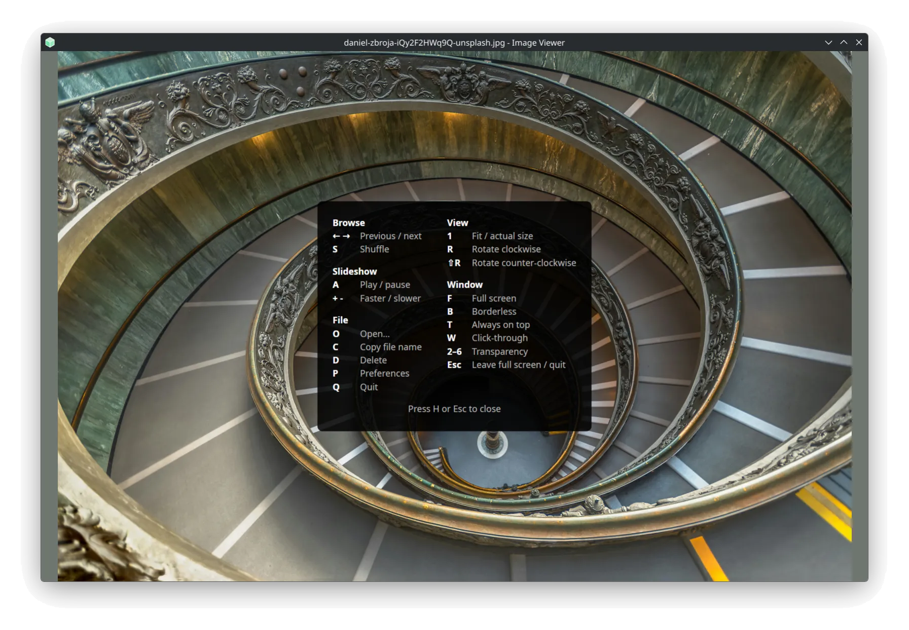

[ImageViewer](/imageviewer/) started as my answer to a slow, chatty Windows Photos app: open a folder, get out of the way, show me the pictures. It did that well, but only on Windows.

I have a confession to make. I've not used Windows in a couple of years now. My personal devices now run Linux, and my work laptop is a MacBook Pro. I did miss having a simple image viewer however.

And so the old ImageViewer finally got the upgrade it needed. Version 2 is a complete rewrite, and it's now faster, better, and cross platform.

## What's new

- **Cross-platform.** Windows, macOS and Linux!
- **Almost every image format.** The usual web formats, plus HEIC, AVIF, JPEG XL, JPEG 2000, TIFF, PSD, SVG, EXR, TGA, DDS and dozens more.
- **Camera raw files** from all the major manufacturers, and they open as fast as a JPEG.
- **Animated GIF and WebP** files now play.
- **A checkerboard** shows behind transparent images.
- **A button to make it your default image viewer**, in Preferences (`P`).
- **A new cheat sheet** of keyboard shortcuts (`H`).

It's still free, and it's permissively licensed under the [GPLv3](https://github.com/LBognanni/ImageViewer/blob/main/LICENSE.md). It still doesn't call home.

## Under the hood

The old app was WinForms and FreeImage, which kept it on Windows. The new one is an [Avalonia](https://avaloniaui.net/) app on .NET 10. It's compiled with Native AOT, so it starts quickly and doesn't need a .NET runtime installed.

Images are decoded by a chain of decoders. **Skia** handles the common formats (JPEG, PNG, WebP, GIF and friends), and **ImageMagick** (via Magick.NET) handles everything else. Raw files are the slow case: developing one takes seconds. So [ImageViewer](/imageviewer/) shows the JPEG preview the camera stores inside the file, and only develops the raw if you zoom in further than the preview allows.

Speed was the design goal from the start, and I think 2.0 is even faster than the old version:

- **Decode ahead of you.** While you look at one picture, the next ones in the direction you're browsing are already being decoded to screen size, so they're usually ready before you press the key.
- **Show something right away.** Each image arrives in up to three quality tiers: a quick small decode, a screen-sized one, and full resolution for zooming. If you hold down the arrow key, [ImageViewer](/imageviewer/) only does the quick decodes and drops work for images you've already skipped past.
- **Draw on the GPU.** Drawing a large image from CPU memory costs over 100 ms per frame, so images are uploaded as GPU textures, and the next one is uploaded while you're still looking at the current one. Shrinking a big photo to fit the window is done by a shader instead of mipmaps, which roughly halves the time to the first frame.

## Download

The [ImageViewer page](/imageviewer/) picks the right download for your system, or you can grab any file from the [latest release](https://github.com/LBognanni/ImageViewer/releases/latest). None of the builds are signed yet, so:

- On **Windows**, if SmartScreen complains, choose *More info*, then *Run anyway*.
- On **macOS**, go to *System Settings* → *Privacy & Security* and choose *Open Anyway* the first time.
- On **Linux**, make the AppImage executable with `chmod +x` before running it.

If you find a file it won't open, or something that feels slow, [open an issue](https://github.com/LBognanni/ImageViewer/issues): I want ImageViewer to be the best app of its kind!
