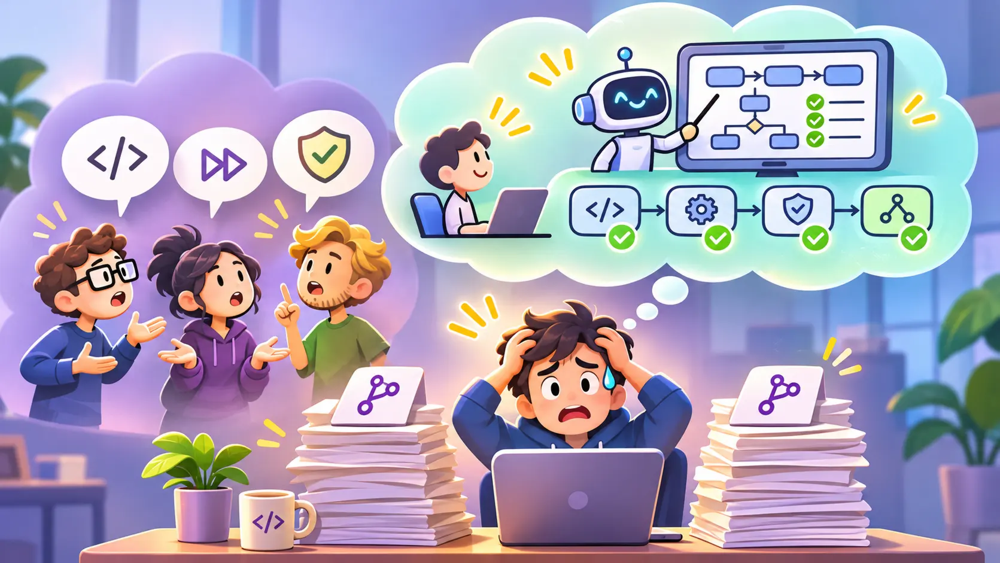

It's fascinating how much AI has changed the job of a software engineer in just a year. We've gone from fancy tab-tab-tab autocomplete to do-it-all software factories at the extreme. (btw, does anyone know someone who wrote a software factory that produced an actual successful application that is not _the software factory itself?_)

The topic of code review is perhaps the hottest discussion in the field. On one side stand the purists, who ask "How can you guarantee quality if you don't review every line of code?"; on another stand the GSD/YOLO people who argue that "we can't review every line of code and move fast at the same time". All while someone reminds them that we don't want to lose our SOC-2 certification so yes, a human must be responsible for the code.

## So, about code reviews

[What's happening at the frontier labs and at leading-edge companies is interesting](#links). A subset of changes get merged as soon as they pass quality gates such as CI pipelines, adversarial review, and security review. The most critical changes still get a human review, but to build context without reading every line, developers will usually _ask AI for some sort of summary_, perhaps as an interactive page with flow diagrams.

Lots of developers elsewhere read about this way of working and shed a tear. They want to go faster, but with review being the bottleneck, PRs inevitably start to pile up and everything grinds to a halt. It's just so much easier to generate code than it is to review it.



It's so easy, in fact, that coding agents have a strong bias for **generating as much code as possible** - writing tests that check for the value of constants, handling edge cases that can never happen in production, inventing requirements. In other words, SLOP.

## Storytime: Tests to fight slop

On a repo I contribute to, there's a GitHub workflow that creates a tag and a pre-release every time someone pushes to a pull request, so that we can deploy the binaries to a test environment (should we choose to do so). On a busy repo with lots of commits, those releases start piling up fast, and at some point querying the GitHub releases API becomes painfully slow or stops responding altogether.

So I asked my agent for a simple Python script to delete those pre-releases when pull requests get merged.

What I got was a totally reasonable but very long script. It had a test file too, which was of course at least as long as the script itself. Looking at the code, my eyes glazed over. I mean, the code was tested and working (I did test the script on an already closed PR), but oh my god I could not make heads or tails of it without some serious focus time. Even looking at the tests, they were all reasonable-sounding, but as clear as mud. 

This, on a side-of-desk type of task while I was busy working on actual things I needed to deliver. (I'll spare you the blog post about CI being a tragedy of the commons and the place where hope goes to die)

I asked for a simple change: Rename the tests so they follow a `When_X_Then_Y` structure.

And then I saw it. **The Slop**. Renaming the tests finally made it clear what all the lines of code were there for. Conditional logic on top of conditional logic for things that can't happen in our setup, like "what if it's a draft release and also a pre-release", "what if this is a release on the main branch" and so on. Technically it was very thorough, but in practice this was just adding cognitive load for zero benefit. [YAGNI](https://en.wikipedia.org/wiki/You_aren%27t_gonna_need_it)!

## A brief history of BDD

Smarter people than me realized that having tests that are easy to read was a Good Thing. Imagine if your test syntax was so simple that you could just write something like:

```
Feature: User login

  Scenario: Successful login
    Given the user is on the login page
    When the user enters valid credentials
    Then the user should be redirected to the dashboard
```

Then you could have, like, domain experts, product managers and business people write the tests! 🤯
Then instead of writing tests first, why not write _behaviours_ first when planning a feature! We could call this BDD instead of TDD for Behaviour-Driven Development! But this is making too much sense. Let's name this stuff something ridiculous like Gherkin because reasons.

This was such a revolutionary idea that it took off in the industry. Consultants showed teams how having a common language was key to understanding each other. Developers excitedly built the underlying test structure so that business folks could write tests in English. Business folks said they'd surely get back to them in a few days; it's just such a busy season now with meetings and phone calls and stuff.

In other words, developers wrote the test framework so that they could then have the privilege of writing the damn `.feature` files themselves. Most saw this and went back to their unit testing framework of choice, reasoning that maintaining an English layer on top of the tests was just extra work.

## Fast forward to now

I started this blog post saying that things have changed. Today's developers write little code and either review lots of it, or trust the machine. There's a third way: review the tests only. As long as they pass, and are testing the right thing, it can be sufficient for the majority of tasks.

But we can take this a step further: Why review the test _implementation_ when you can review its purpose? Two of the reasons for the disappointing adoption of BDD have now been flipped on their heads: the developer is now a stakeholder and her job looks a lot like yesterday's product manager, while the code writing is done by an ever compliant LLM that will follow whatever rules you set for it.

> We don't even have to _write_ the tests. We just need to read them. 
> And when they're written in plain English, suddenly reviewing is a lot simpler. 

The new workflow can look like this: you describe the intent, the agent writes the code change, the scenarios and the step definitions, and you review the scenarios. You don't have to stay so close to the implementation that you have to keep every function and variable name in your mental model. By all means, go deep when you need to, but for most work you can just speak in domain language.

Remember those frontier teams asking the AI for a summary instead of reading the code? A `.feature` file is that summary, except it's versioned, reviewable, and helps catch regressions. And it lets a human vouch for every change without reading every line, which keeps the SOC-2 crowd happy too.

This is why I think BDD will be making a comeback in 2027. 

## A scenario

```gherkin
Scenario: Deleting a draft pre-release on the main branch
  Given a release is on the main branch
  And it is a pre-release
  And it is a draft release
  When the pull request is merged
  ...
  
STOP OMG PLS STOP IT WILL NEVER HAPPEN FFS
```

_fin._

---

<a id="links"></a>
#### Sources and further reading
1. Anthropic - [How the Claude Code team does code review](https://claude.dev/blog/solving-code-review-at-anthropic/)
1. PostHog - [Stop being the code review bottleneck](https://posthog.com/newsletter/code-review-tips)
1. Linear - [Reviewing code in the agent era](https://linear.app/now/reviewing-code-in-the-agent-era)
1. Cloudflare - [Orchestrating AI Code Review at scale](https://blog.cloudflare.com/ai-code-review)
