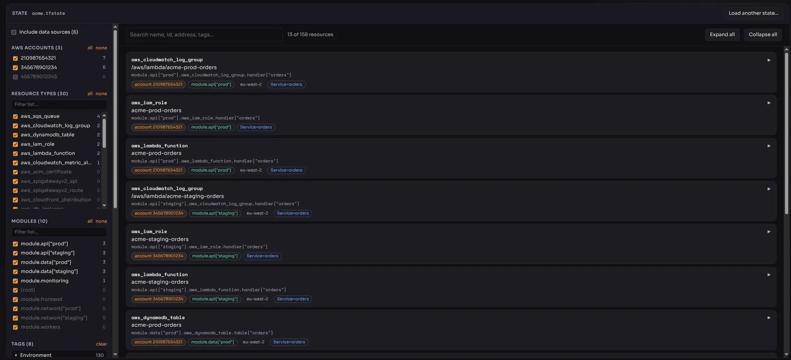
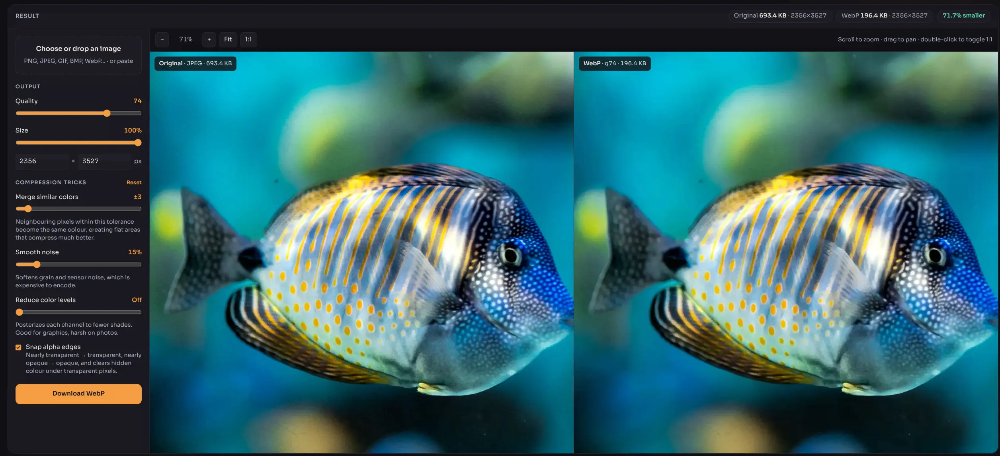

There are two new additions to the [Vibelets](https://codemade.net/#vibelets) collection!

If you missed [the original post](/blog/vibelets/), vibelets are tiny, single-purpose web apps that an LLM built for me, and that run entirely in your browser. Nothing is uploaded: when you use them, no data ever leaves your machine. You open the page, you do the thing, you close the tab.

Here's what Claude has been cooking for me recently:

## Terraform State Viewer

> 🏗️ [Open the Terraform State Viewer](/vibelets/terraform-state-viewer/)

If you've worked with Terraform for any amount of time, you know the state file is where the truth lives. You also know that it's a giant blob of JSON. Making sense of it can be incredibly difficult.

State files also **often contains secrets in plain text**. 

When it was my turn to understand the resources in a state file, after a few failed attempts at `jq`ing my way into it, I built Terraform State Viewer: a simple but powerful UI where all the processing happens right in your browser, on your machine. Your state file is never transmitted anywhere!

Drop a `terraform.tfstate` file onto the page, or paste the output of `terraform show -json`, and you get a searchable list of every resource. From there, you can:

- **Filter by AWS account, resource type, module or tag.** The account is worked out from each resource's ARN, or its owner ID, or from the other resources that share its provider, so multi-account setups get split up automatically.
- **See live counts next to each filter**, showing how many resources you'd get if you selected it given everything else you've already selected. It's the same kind of faceted search you get on a shopping site, but for your infrastructure.
- **Search everything**: names, IDs, addresses, ARNs and tags.
- **Expand any resource** to see its full attributes, and copy them as JSON.

Data sources are hidden by default, because most of the time you care about what Terraform actually manages, but there's a toggle to bring them back.

## WebP Converter

> 🗜️ [Open the WebP Converter](/vibelets/webp-converter/)

I've always been a huge fan of [TinyPNG](https://tinypng.com) and its sister site [TinyJPG](https://tinyjpg.com), two fantastic web apps that let you compress your image files with very little loss of quality. 

Nowadays WebP is supported by all major browsers, and it compresses much better than either jpeg or png. So as I was drafting a new blog post, I decided to convert my hero image into webp to save on some precious bytes.

Imagine my surprise when I discovered that there's no TinyWebP! So I had Claude build me one.

Drop, choose or paste an image (PNG, JPEG, GIF, or anything else your browser can open), and the WebP version appears right next to the original. Zoom and pan are synced between the two, so you can scroll into a detail and check for compression artifacts in both images at once. The file size and how much you saved update as you tweak the settings.

Besides the usual quality and size controls, there are a few **compression tricks** that can make files a lot smaller, especially for screenshots and graphics:

- **Merge similar colors** turns pixels that are almost the same color into exactly the same color. Flat areas compress much better.
- **Smooth noise** softens grain and sensor noise, which is surprisingly expensive to encode.
- **Reduce color levels** posterizes the image. Great for graphics, harsh on photos.
- **Snap alpha edges** cleans up transparency: nearly transparent pixels become fully transparent, nearly opaque ones become fully opaque, and the hidden color under transparent pixels is cleared.

One caveat: the conversion uses your browser's own WebP encoder, and Safari doesn't have one. Use Chrome, Edge or Firefox instead.
